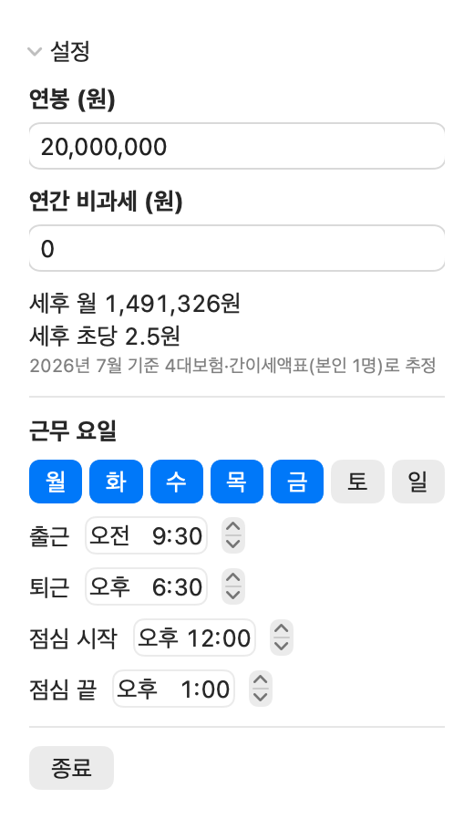

# salary-ticker

연봉과 연간 비과세액을 넣어 두면 근무 시간(점심시간 제외) 동안 오늘 번 돈(세후)이 macOS 메뉴바에 1초마다 올라가는 숫자로 보이는 앱입니다. 메뉴바에는 "원" 같은 단위 없이 숫자만 나옵니다.

## 스크린샷


실제 메뉴바를 캡처한 화면입니다(예시 연봉 2천만 원). 숫자가 1초마다 올라갑니다.




메뉴바 숫자를 눌렀을 때 열리는 패널입니다. 위는 설정이 접힌 상태, 아래는 "설정"을 펼친 상태입니다. 실제 화면 코드로 그린 이미지입니다(예시 연봉 2천만 원, 월요일 14:00).

## 요구 사항

- macOS 14(Sonoma) 이상
- Swift 6 툴체인(Xcode 16 이상)

## 실행

```bash
swift run
```

Dock에는 아이콘이 나오지 않고 메뉴바에만 숫자가 나타납니다.

## 사용법

1. 메뉴바 숫자를 누르면 패널이 열립니다. 연봉이 보이지 않도록 설정은 접혀 있으니 "설정"을 눌러 펼칩니다. 패널을 닫으면 다시 접힙니다.
2. 연봉(원)과 연간 비과세(원)를 입력하고 Enter를 누릅니다. 숫자와 쉼표만, 1조 원 이하로 입력합니다. 잘못된 값은 저장하지 않고 이전 값을 유지합니다. 비과세 칸을 비우면 0입니다. 예: 식대 월 20만 원이면 연간 비과세 2,400,000.
3. 근무 요일, 출근·퇴근 시각, 점심 시작·끝 시각을 고릅니다. 기본값은 월~금 09:30~18:30, 점심 12:00~13:00입니다. 퇴근 시각은 출근 시각보다 늦어야 하고, 점심시간은 출근과 퇴근 사이여야 합니다. 점심 시작과 끝을 같게 하면 점심시간 없이 셉니다.
4. 설정을 펼치면 세후 월급과 세후 초당 금액이 보입니다. 연봉을 아직 넣지 않았으면 접힌 상태에서도 "연봉을 입력하세요"가 보입니다. 앱 종료는 패널의 종료 버튼이나 ⌘Q입니다.

## 계산 방식

**세후 1년 급여**

- 과세 월급여 = (연봉 - 연간 비과세) ÷ 12
- 매달 빼는 돈(각 10원 미만 버림)
  - 국민연금: 기준소득월액(과세 월급여, 41만~659만 원) × 4.75%
  - 건강보험: 과세 월급여 × 3.595%
  - 장기요양보험: 건강보험료 × 0.9448 ÷ 7.19
  - 고용보험: 과세 월급여 × 0.9%
  - 근로소득세: 근로소득 간이세액표(소득세법 시행령 별표2, 2026.2.27 개정)의 공제대상가족 1명(본인) 세액
  - 지방소득세: 근로소득세 × 10%
- 세후 1년 급여 = 연봉 - 매달 빼는 돈 × 12

요율은 2026년 7월 기준입니다. 부양가족, 자녀, 회사마다 다른 공제(사우회비 등)는 반영하지 않으니 실제 급여명세서와 다를 수 있습니다.

**오늘 번 돈**

- 하루 근무 초 = 출근부터 퇴근까지에서 점심시간을 뺀 초(기본 8시간)
- 초당 금액 = 세후 월급(세후 1년 급여 ÷ 12) ÷ (그 달 1일~말일 중 근무 요일 수 × 하루 근무 초). 달마다 근무일 수가 달라 초당 금액도 달라집니다.
- 오늘 번 돈 = 초당 금액 × 오늘 출근 시각부터 일한 초. 원 단위 아래는 버립니다.
- 점심시간에는 멈추고, 퇴근 시각이 지나면 그날 일급에서 멈추며, 자정에 0으로 돌아갑니다. 근무 요일이 아닌 날은 종일 0입니다.
- 공휴일은 따로 빼지 않습니다.

예: 연봉 20,000,000원, 비과세 0, 기본 시간표, 2026년 11월(근무일 21일)이라면 세후 월 1,491,326원, 초당 약 2.47원, 월요일 14:00에 31,069입니다.

## 저장

연봉, 비과세액, 근무 시간표는 이 기기의 UserDefaults에만 저장합니다. 네트워크로 보내지 않습니다.

## 개발

작업을 마치기 전에 아래를 모두 통과시킵니다.

```bash
swift format lint --strict --recursive Package.swift Sources Tests
swift test
swift build
```

커밋 전에 포맷 검사를 돌리려면 저장소의 훅을 켭니다.

```bash
git config core.hooksPath .githooks
```

README 패널 이미지는 `RENDER_SCREENSHOTS=1 swift test --filter ScreenshotTests`로 다시 만듭니다(평소 `swift test`에서는 건너뜁니다).
