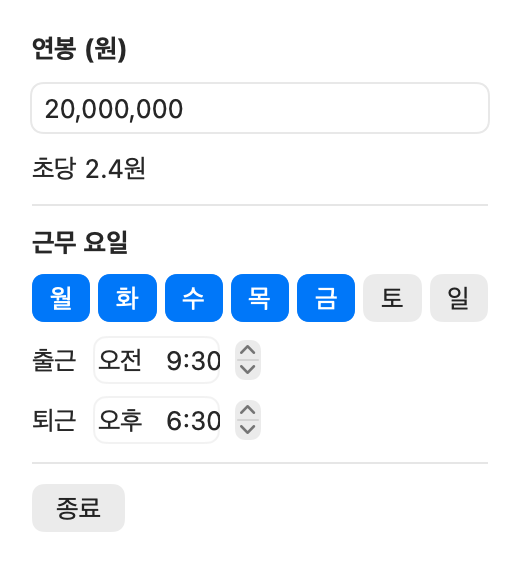
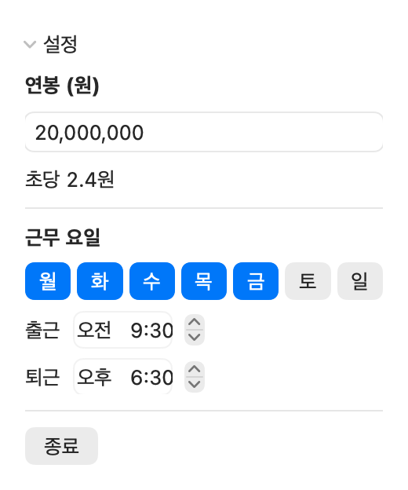

# salary-ticker

연봉을 넣어 두면 근무 시간 동안 오늘 번 돈이 macOS 메뉴바에 1초마다 올라가는 숫자로 보이는 앱입니다. 메뉴바에는 "원" 같은 단위 없이 숫자만 나옵니다.

## 스크린샷


실제 메뉴바를 캡처한 화면입니다(예시 연봉 2천만 원, 평일 17시 50분 무렵). 숫자가 1초마다 약 2.4씩 올라갑니다.





메뉴바 숫자를 눌렀을 때 열리는 패널입니다. 위는 설정이 접힌 상태, 아래는 "설정"을 펼친 상태입니다. 실제 화면 코드로 그린 이미지입니다(예시 연봉 2천만 원, 월요일 14:00).

## 요구 사항

- macOS 14(Sonoma) 이상
- Swift 6 툴체인(Xcode 16 이상)

## 실행

```bash
swift run
```

Dock에는 아이콘이 나오지 않고 메뉴바에만 숫자가 나타납니다.

## 사용법

1. 메뉴바 숫자를 누르면 패널이 열립니다. 연봉이 보이지 않도록 설정은 접혀 있으니 "설정"을 눌러 펼칩니다. 패널을 닫으면 다시 접힙니다.
2. 연봉(원)을 입력하고 Enter를 누릅니다. 숫자와 쉼표만, 1조 원 이하로 입력합니다. 잘못된 값은 저장하지 않고 이전 연봉을 유지합니다.
3. 근무 요일과 출근·퇴근 시각을 고릅니다. 기본값은 월~금 09:30~18:30입니다. 퇴근 시각은 출근 시각보다 늦어야 합니다.
4. 설정을 펼치면 초당 금액이 보입니다. 연봉을 아직 넣지 않았으면 접힌 상태에서도 "연봉을 입력하세요"가 보입니다. 앱 종료는 패널의 종료 버튼이나 ⌘Q입니다.

## 계산 방식

- 초당 금액 = 연봉 ÷ (52주 × 주 근무일 수 × 하루 근무 초)
- 오늘 번 돈 = 초당 금액 × 오늘 출근 시각부터 지난 초. 원 단위 아래는 버립니다.
- 퇴근 시각이 지나면 그날 일급에서 멈추고, 자정에 0으로 돌아갑니다. 근무 요일이 아닌 날은 종일 0입니다.
- 휴게시간과 공휴일은 따로 빼지 않습니다.

예: 연봉 20,000,000원, 기본 시간표라면 초당 약 2.37원, 월요일 14:00에 38,461, 퇴근 시각에 일급 76,923입니다.

실수령액 기준으로 보고 싶으면 연봉 칸에 월 실수령액 × 12를 넣으세요.

## 저장

연봉과 근무 시간표는 이 기기의 UserDefaults에만 저장합니다. 네트워크로 보내지 않습니다.

## 개발

작업을 마치기 전에 아래를 모두 통과시킵니다.

```bash
swift format lint --strict --recursive Package.swift Sources Tests
swift test
swift build
```

커밋 전에 포맷 검사를 돌리려면 저장소의 훅을 켭니다.

```bash
git config core.hooksPath .githooks
```

README 패널 이미지는 `RENDER_SCREENSHOTS=1 swift test --filter ScreenshotTests`로 다시 만듭니다(평소 `swift test`에서는 건너뜁니다).
